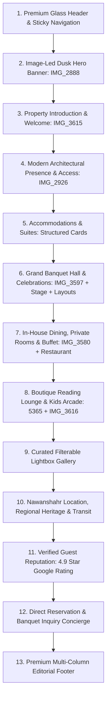

# Implementation Plan: Hotel De Symphony by Topaz
**Primary Implementation Blueprint for Developer / Gemini**  
**Property:** Hotel De Symphony by Topaz, Nawanshahr, Punjab, India  
**Target Codebase Directory:** `D:\SYMPHONY`  
**Document Status:** Implementation-Ready Architecture  
**Version:** 1.0.0 (Production Blueprint)  

---

## 1. Project Overview & Core Directive

### 1.1 Objective
This document serves as the **master engineering and visual blueprint** for building the official marketing and reservation website for **Hotel De Symphony by Topaz**, a premier contemporary hospitality property situated in Nawanshahr (Shaheed Bhagat Singh Nagar District), Punjab.

### 1.2 Design Philosophy & Visual Translation
The website adapts the refined visual rhythm of high-end editorial hospitality references. It prioritizes:
- **Generous negative space**, deliberate typographic hierarchy, and warm architectural neutrals.
- **Visual authenticity**: Every visual claim is backed by real photography from `./photos/`. Irrelevant alpine, mountain, skiing, or generic international resort tropes are strictly omitted.
- **Ground truth integrity**: No fake booking backends, no invented room categories, no invented accolades, and no unverified amenities.
- **Direct hospitality conversions**: Streamlined click-to-call, WhatsApp concierge routing, and clear Google Maps navigational assistance.

---

## 2. Existing Assets & Codebase Analysis

### 2.1 Workspace Structure
The project directory currently contains:
```
D:\SYMPHONY/
├── photos/                        # 47 raw photographic assets
├── CONTACT_SHEET/                 # Generated photographic contact sheets & interactive viewer
│   ├── contact_sheet_part_1.png   # Exterior, Lobby & Kids Area
│   ├── contact_sheet_part_2.png   # Grand Banquet Hall series
│   ├── contact_sheet_part_3.png   # Dining, Restaurant & Catering
│   ├── contact_sheet_part_4.png   # Events, Table Setups & Cafe
│   └── index.html                 # Interactive browser-based visual audit viewer
├── ASSET_MAP.md                   # Definitive mapping of every image to section & crop strategy
├── IMAGE_MANIFEST.json            # Machine-readable asset metadata & section assignments
├── CONTENT_AUDIT.md               # Empirical boundary of verified facts vs unknowns
└── IMPLEMENTATION_PLAN.md         # This primary blueprint
```

### 2.2 Photographic Asset Distribution
A total of **47 files** were audited:
- **8 files** are exact byte duplicates (MD5 confirmed) and are discarded from build manifests.
- **1 file** (`5327`) depicts back-of-house commercial stacked crockery and is excluded.
- **38 unique images** are active in the website architecture:
  - **High-Resolution Master Series (20 files):** 8064×4536 and 6000×3368 px (4 MB to 10.3 MB). Ideal for hero displays, expansive section banners, and full-screen lightbox previews.
  - **Standard-Resolution Interior Series (18 files):** 1280×720 px (146 KB to 300 KB). Optimized for editorial mosaic cards, culinary vignettes, and mobile feature grids.

### 2.3 The Critical Asset Discovery & Implementation Mandate
> [!CRITICAL]
> **NO GUEST BEDROOM OR BATHROOM PHOTOS EXIST IN THE LOCAL ASSET REPOSITORY.**
> The developer must NOT use banquet or dining photographs as room placeholders. Instead:
> 1. The **Rooms & Suites Section** must be rendered using structured architectural card designs, verified room specifications (Deluxe Double Room ~168 sq. ft., Royal Deluxe Room ~195 sq. ft.), verified amenity checklists, and a clear editorial badge: *"Direct Booking & Availability Inquiries Open — Room Visuals Updating Soon"*.
> 2. The website will prominently lead with the hotel's verified crown jewels: the **Grand Banquet & Wedding Venue**, the **Multi-Cuisine Restaurant & Private Dining Rooms**, the **Boutique Cafe & Reading Lounge**, and the **Children's Indoor Arcade Zone**.

---

## 3. Design System Specification

### 3.1 Color Palette
The color system is derived directly from the physical building materials, warm interior wood paneling, traditional brass *thali* dinnerware, and the dusk facade lighting observed in `IMG_2888.JPG.jpeg`.

```css
:root {
  /* Primary Foundations */
  --color-canvas-dark:        #11141A; /* Deep Architectural Slate / Obsidian */
  --color-canvas-card:        #181C24; /* Elevated Dark Surface */
  --color-canvas-light:       #FBF9F5; /* Warm Alabaster / Linen (Light Sections) */
  --color-canvas-muted:       #F2EFEB; /* Soft Sandstone Background */
  
  /* Brand Accent & Heritage Gold */
  --color-gold-primary:       #C5A265; /* Muted Antique Brass / Warm Gold */
  --color-gold-hover:         #D6B57C; /* Radiant Champagne Hover */
  --color-gold-subtle:        rgba(197, 162, 101, 0.12); /* Ambient Gold Glow */
  --color-gold-border:        rgba(197, 162, 101, 0.28); /* Architectural Filigree Border */

  /* Text & Readability */
  --color-text-on-dark:       #F8FAFC; /* Primary Crisp Off-White */
  --color-text-muted-dark:    #94A3B8; /* Slate Gray Secondary Text */
  --color-text-on-light:      #1E2229; /* Deep Charcoal Heading on Light */
  --color-text-muted-light:   #64748B; /* Secondary Body on Light */

  /* Functional / Status */
  --color-border-subtle:      rgba(255, 255, 255, 0.08);
  --color-whatsapp:           #25D366; /* Verified WhatsApp Action */
}
```

### 3.2 Typography Hierarchy
- **Primary Editorial Heading:** High-contrast luxury serif (`Cormorant Garamond`, `Playfair Display`, or `Cinzel`).
- **Body & Technical UI:** High-legibility humanist sans-serif (`Plus Jakarta Sans` or `Inter`).

| Role | Font Family | Size (Desktop) | Size (Mobile) | Weight | Line Height | Tracking |
|---|---|---|---|---|---|---|
| **Display Hero** | Serif | 56px – 64px | 36px – 40px | 600 SemiBold | 1.1 | -0.02em |
| **Section Title (H1)** | Serif | 40px – 48px | 28px – 32px | 500 Medium | 1.2 | -0.01em |
| **Subsection (H2)** | Serif | 28px – 32px | 22px – 24px | 600 SemiBold | 1.3 | normal |
| **Card Heading (H3)**| Sans-Serif | 18px – 20px | 16px – 18px | 600 SemiBold | 1.4 | normal |
| **Body Large** | Sans-Serif | 18px | 16px | 400 Regular | 1.65 | normal |
| **Body Regular** | Sans-Serif | 15px – 16px | 14px – 15px | 400 Regular | 1.6 | normal |
| **Kicker / Overline** | Sans-Serif | 12px – 13px | 11px | 700 Bold | 1.0 | +0.15em (Uppercase) |
| **Caption / Meta** | Sans-Serif | 13px | 12px | 400 Regular | 1.4 | normal |

### 3.3 Spacing & Layout Grid
- **Baseline Unit:** 8px.
- **Section Vertical Spacing:**
  - Desktop: `100px – 120px` padding top & bottom.
  - Tablet: `72px – 80px`.
  - Mobile: `48px – 60px`.
- **Content Max-Widths:**
  - Standard Content Container: `1240px` (with `24px` gutter on mobile).
  - Editorial Reading Container: `760px`.
  - Full-Bleed Breakout Media: `100vw` with internal `1440px` constraint.

### 3.4 Responsive Breakpoints
```css
--breakpoint-sm: 640px;   /* Mobile landscape */
--breakpoint-md: 768px;   /* Tablets */
--breakpoint-lg: 1024px;  /* Small laptops / Desktop */
--breakpoint-xl: 1280px;  /* Standard Desktop */
--breakpoint-2xl: 1536px; /* Ultra-wide displays */
```

### 3.5 Interaction & Motion Principles
1. **Subtle Elevation & Parallax:** Background hero images use smooth CSS transform translations (`transform: scale(1.02)` on page load over 1.2s cubic-bezier ease).
2. **Glassmorphism Navigation:** Fixed header transitions from transparent to `rgba(17, 20, 26, 0.85)` with `backdrop-filter: blur(12px)` and a thin border `rgba(197, 162, 101, 0.2)` upon scrolling past 50px.
3. **Card Micro-Interactions:** Image cards zoom slightly (`scale(1.03)`) inside `overflow: hidden` containers with a `0.4s ease-out` curve.
4. **Accessible Reduced Motion:** Respect `prefers-reduced-motion: reduce` by disabling non-essential transitions.

---

## 4. Final Information Architecture & Section Hierarchy

The website follows an adapted 13-section editorial narrative structure:



---

## 5. Section-by-Section Engineering Specifications

### Section 1: Premium Header & Navigation
- **Height:** 80px (Desktop), 68px (Mobile).
- **Positioning:** Fixed at `top: 0; left: 0; right: 0; z-index: 1000`.
- **Background:** Transparent initially; switches to `rgba(17, 20, 26, 0.92)` with `backdrop-filter: blur(14px)` on scroll (`isScrolled > 40px`).
- **Brand Identity:**
  - Left: "HOTEL DE SYMPHONY" in tracking `0.18em` serif uppercase, with subtitle "BY TOPAZ • NAWANSHAHR" in 9px sans-serif gold uppercase.
- **Desktop Navigation Links:**
  - `Overview` (`#overview`)
  - `Accommodations` (`#rooms`)
  - `Grand Banquets` (`#banquets`)
  - `Dining & Catering` (`#dining`)
  - `Amenities` (`#amenities`)
  - `Gallery` (`#gallery`)
  - `Location` (`#location`)
- **Direct Actions (Right):**
  - Telephone Quick-Dial: `tel:+919875954404` (displays `+91 98759 54404` with phone icon).
  - WhatsApp CTA Button: Golden outline pill button reading "Inquire / WhatsApp".
- **Mobile Menu:** Fullscreen animated drawer with gold borders, oversized navigation typography (24px serif), and one-tap call/WhatsApp triggers.

---

### Section 2: Image-Led Dusk Hero Section
- **Height:** `85vh` on desktop (`min-height: 640px; max-height: 900px`); `80vh` on mobile.
- **Background Asset:** `photos/IMG_2888.JPG.jpeg` (8064×4536 px master).
- **CSS Cropping:** `object-fit: cover; object-position: center 38%;` (preserves the illuminated rooftop signage and evening sunset gradient; crops out lower parking lot).
- **Overlay:** Dual linear gradient:
  - Top-to-bottom: `linear-gradient(180deg, rgba(17, 20, 26, 0.65) 0%, rgba(17, 20, 26, 0.2) 40%, rgba(17, 20, 26, 0.85) 100%)`.
- **Content Alignment:** Center-aligned bottom-third container.
- **Typography:**
  - Kicker: `WELCOME TO NAWANSHAHR'S DISTINGUISHED ADDRESS` (13px, tracking 0.2em, gold).
  - Headline: `"Where Modern Architectural Elegance Meets Punjab's Timeless Hospitality"` (Serif, 54px desktop / 34px mobile, off-white).
  - Sub-paragraph: `"Discover grand celebration halls, authentic fine dining, and refined comfort in the heart of Shaheed Bhagat Singh Nagar District."` (17px sans-serif, max-width 640px).
- **CTAs:**
  - Primary Button (Solid Gold): "Plan a Banquet or Event" (smooth-scrolls to `#banquets`).
  - Secondary Button (Glass Outline): "Direct Reservation" (opens WhatsApp concierge).
- **Hero Metadata Strip (Bottom):** 3-metric bar displaying:
  - `4.9 ★` on Google Reviews (100+ Verified Guests)
  - `Grand Banquet Hall` for 250+ Guests
  - `Prime Access` on Barnala Kalan Road

---

### Section 3: Hotel Introduction & Welcome
- **Section ID:** `#overview`
- **Background:** Dark Slate Canvas (`--color-canvas-dark`).
- **Layout:** Asymmetric 2-column editorial grid (Desktop 55% text / 45% media).
- **Text Column (Left):**
  - Kicker: `BOUTIQUE COMFORTS IN DOABA`
  - Title: `"A Sanctuary of Refined Hospitality in Nawanshahr"`
  - Body:
    > "Positioned along Barnala Kalan Road in Nawanshahr, Hotel De Symphony by Topaz redefines regional boutique hospitality. Whether hosting lavish wedding receptions in our grand banquet suites, gathering for intimate family celebrations over authentic North Indian cuisine, or traveling on executive business through Punjab, our property delivers contemporary architectural sophistication anchored by genuine warmth."
  - Feature Points:
    - *Spacious Private Parking & Round-the-Clock Security*
    - *In-House Multi-Cuisine Culinary & Banquet Catering*
    - *Strategic Highway Access to Jalandhar, Chandigarh & Banga*
- **Visual Column (Right):**
  - Asset: `photos/IMG_3615.JPG.jpeg` (6000×3368 px).
  - Subject: The boutique lobby lounge under the staircase featuring framed classical Indian figurative artwork, leather tub chair, and warm wall sconce.
  - CSS Framing: `aspect-ratio: 4/5; object-fit: cover; object-position: 45% center; border: 1px solid var(--color-gold-border);` with an offset decorative gold shadow frame.

---

### Section 4: Modern Architectural Presence & Property Access
- **Background:** Elevated Slate (`--color-canvas-card`).
- **Layout:** Wide editorial banner card paired with transit and property stats.
- **Visual Asset:** `photos/IMG_2926.JPG.jpeg` (8064×4536 px night exterior).
- **Composition:** 16:9 cinematic card with glowing facade signage against the deep blue night sky.
- **Narrative Points:**
  - *Architectural Facade:* 5-story contemporary glass-and-steel commercial landmark with private gated parking.
  - *24/7 Front Desk & Full Power Generator Backup:* Continuous comfort regardless of municipal power fluctuations.
  - *Driver Accommodation & Valet Space:* Dedicated space for traveling chauffeurs and family vehicles.

---

### Section 5: Accommodations & Stay (Rooms Section)
- **Section ID:** `#rooms`
- **Background:** Soft Parchment / Light Linen (`--color-canvas-light`) with Dark Charcoal Text (`--color-text-on-light`). *Creates high-end editorial contrast with surrounding dark sections.*
- **Section Header:**
  - Kicker: `RESTFUL RETREATS`
  - Title: `"Thoughtfully Appointed Living Spaces"`
  - Description: `"Designed for visiting wedding parties, business executives, and regional travelers seeking clean, quiet comfort in Nawanshahr."`
- **Editorial Room Cards (2-Column Grid):**
  
  #### Card 1: Deluxe Double Room
  - **Estimated Dimensions:** ~168 sq. ft.
  - **Bed Configuration:** 1 Comfortable Double Bed with crisp white linens.
  - **Occupancy:** 2 Adults.
  - **Verified In-Room Amenities:**
    - Air Conditioning & Individual Climate Control
    - Complimentary High-Speed Wi-Fi
    - Flat-Screen TV with Digital Cable
    - Dedicated Work Desk & Seating
    - En-Suite Private Bathroom with Geyser / Hot Water
    - Daily Housekeeping & 24-Hour Room Service
  - **Tariff Notice:** `"Indicative tariff: ₹2,100 – ₹3,000 / night (rates vary by season; taxes extra)"`
  - **Direct Booking CTA:** `"Inquire for Dates"` (launches WhatsApp with pre-filled message: `"Hi, I'd like to check availability for the Deluxe Double Room"`).

  #### Card 2: Royal Deluxe Room
  - **Estimated Dimensions:** ~195 sq. ft.
  - **Bed Configuration:** 1 Premium Queen Bed with upgraded headboard.
  - **Occupancy:** Up to 3 Guests (with extra bedding).
  - **Verified In-Room Amenities:**
    - Expanded Living Space with Plush Sofa / Tub Seating
    - Individual Climate Control (AC)
    - Electric Kettle / Tea & Coffee Station
    - Flat-Screen Television with Premium Channels
    - Work Desk & Charging Hub
    - Spacious En-Suite Bathroom with Fresh Toiletries & 24h Hot Water
    - Express In-Room Dining & Laundry Service
  - **Tariff Notice:** `"Indicative tariff: ₹2,800 – ₹4,000 / night (rates vary by season; taxes extra)"`
  - **Direct Booking CTA:** `"Inquire for Dates"` (launches WhatsApp).

- **Editorial Asset Disclosure Box (Below Cards):**
  - Styled callout box with gold border:  
    > *"Note for Guests: Room photography is currently being re-captured to our new visual standard. All room bookings, corporate group blocks, and wedding guest reservations are managed directly via our front desk at `+91 98759 54404` or via WhatsApp."*

---

### Section 6: Grand Banquet Hall & Celebrations
- **Section ID:** `#banquets`
- **Background:** Dark Slate (`--color-canvas-dark`).
- **Section Header:**
  - Kicker: `CELEBRATIONS & CEREMONIES`
  - Title: `"The Grand Symphony Banquet Hall"`
  - Description: `"Nawanshahr's premier venue for dream Punjabi weddings, glamorous ring ceremonies, anniversary galas, and high-impact corporate summits."`

- **Lead Panoramic Hero Banner:**
  - Asset: `photos/IMG_3597.JPG.jpeg` (6000×3368 px).
  - Ratio: 21:9 wide panoramic crop (`height: 480px; object-fit: cover; object-position: center center;`).
  - Overlay: Subtle gradient vignette with overlaid feature metrics:
    - *Capacity: 150 – 250+ Seated Guests*
    - *Multi-Tier Illuminated Coffered Ceiling*
    - *Seamless High-Polish Marble Flooring*

- **3-Column Feature Mosaic Grid:**
  1. **Weddings & Receptions Card:**
     - Asset: `photos/IMG_3546.JPG.jpeg` (6000×3368 px).
     - **Mandatory Crop:** `object-position: center 60%;` (crop top 8% to eliminate the utilitarian "WASH ROOM" sign).
     - Content: Highlights wedding stage capabilities with floral arches, sequined fabrics, and custom backdrops.
  2. **Corporate & Social Gatherings Card:**
     - Asset: `photos/IMG_3552.JPG.jpeg` (6000×3368 px).
     - Content: Shows expansive floor plan, dark timber columns, acoustic damask wallpaper, and professional seating arrangements.
  3. **Event Table Styling & Hospitality Card:**
     - Asset: `photos/IMG_3563.JPG.jpeg` (6000×3368 px).
     - Content: Illustrates round banquet tables with black spandex covers, floral sashes, and mirror-reflected lighting.

- **Banquet Inquiry Bar:**
  - Direct RFP action button: `"Request Banquet Date & Catering Quote"` (opens modal / WhatsApp inquiry).

---

### Section 7: Dining, Restaurant & Banquet Catering
- **Section ID:** `#dining`
- **Background:** Elevated Slate (`--color-canvas-card`).
- **Section Header:**
  - Kicker: `CULINARY EXCELLENCE`
  - Title: `"Flavors Crafted for Celebration"`
  - Description: `"From multi-course Punjabi wedding feasts and lavish live buffets to intimate à la carte family dinners."`

- **Lead Dining Hero Banner:**
  - Asset: `photos/IMG_3580.JPG.jpeg` (6000×3368 px master).
  - Crop: Symmetrical head-on perspective (`object-position: center center; height: 420px;`).
  - Narrative: Showcases traditional Indian royal dining (*thali* place settings with engraved brass platters, wine-glass folded napkins, and fresh pink carnation centerpieces).

- **Asymmetric 4-Card Culinary Grid:**
  - **Card 1: The Main Restaurant Ambiance:**
    - Asset: `photos/AMIT SINGH20260708_5377T01.JPG(1).jpeg` (1280×720).
    - Subject: Modern restaurant banquettes with plum and teal tub chairs and backlit laser-cut floral panels.
  - **Card 2: The Sculptural Buffet & Culinary Counter:**
    - Asset: `photos/AMIT SINGH20260708_5374T01.JPG(1).jpeg` (1280×720).
    - Subject: Modern curved buffet counter, custom pendant fixtures, and flowing false ceiling architecture.
  - **Card 3: Executive Private Dining Suite:**
    - Asset: `photos/IMG_3579.JPG.jpeg` (6000×3368).
    - Subject: 16-seat conference table with carved heritage timber chairs and chevron linens.
  - **Card 4: Live Banquet Buffet Catering:**
    - Asset: `photos/AMIT SINGH20260708_5323T01.JPG.jpeg` (1280×720).
    - Subject: Stainless steel multi-chafing line for hot buffet service.

---

### Section 8: Lounge, Lifestyle & Family Amenities
- **Section ID:** `#amenities`
- **Background:** Dark Slate (`--color-canvas-dark`).
- **Layout:** 2-column lifestyle presentation.

#### Column A: The Boutique Reading Lounge & Cafe
- **Primary Asset:** `photos/AMIT SINGH20260708_5365T01.JPG(1).jpeg` (1280×720).
- **Secondary Asset Inset:** `photos/AMIT SINGH20260708_5366T01.JPG(1).jpeg` (1280×720 - book details).
- **Narrative:** Introduces the hotel's relaxing lifestyle lounge featuring an open magenta bookshelf stocked with classic world literature (*The Food of India*, *Frankenstein*, thriller novels) and comfortable seating with natural daylight.

#### Column B: Children's Arcade & Game Zone
- **Primary Asset:** `photos/IMG_3616.JPG.jpeg` (6000×3368 px).
- **Narrative:** Highlights the dedicated family entertainment zone equipped with electronic arcade games (*Spin & Stop*, *Colorama*, *Bear's Treasure* claw machine, and plush prizes). Reassures wedding parties and visiting families that children have engaging on-site entertainment.

#### Universal Facilities Grid (4 Key Badges):
1. **Complimentary High-Speed Wi-Fi** throughout rooms, lounge, and event halls.
2. **100% Automatic Power Backup** with commercial generators for uninterrupted events.
3. **Dedicated Guest Elevator & Accessibility** across all accommodation floors.
4. **24-Hour Front Desk & Daily Housekeeping** with attentive regional staff.

---

### Section 9: Curated Photographic Lightbox Gallery
- **Section ID:** `#gallery`
- **Background:** Obsidian Canvas (`#0B0D12`).
- **Filter Tabs:**
  - `All Photographs` (18 curated unique assets)
  - `Grand Banquets` (Wide angles, stage, dressed tables)
  - `Dining & Tableware` (Brass thali settings, buffet, restaurant rooms)
  - `Architecture & Interiors` (Exterior dusk, night, lobby, lounge)
- **Gallery Grid:** CSS masonry or responsive flex-grid with aspect ratios 16:9, 4:3, and 3:4.
- **Interactive Lightbox Feature:**
  - Clicking any thumbnail opens a full-viewport modal lightbox.
  - Displays original high-resolution master asset with photographic caption and metadata.
  - Full keyboard accessibility: `ArrowRight` (Next), `ArrowLeft` (Previous), `Escape` (Close).
  - Touch swipe enabled for mobile devices.

---

### Section 10: Nawanshahr Location, Regional Heritage & Transit
- **Section ID:** `#location`
- **Background:** Soft Parchment / Light Linen (`--color-canvas-light`) with Dark Charcoal Text.
- **Address Display:**
  > **Hotel De Symphony by Topaz**  
  > Barnala Kalan Road, Near Toor Colony, Rai Colony,  
  > Nawanshahr, Punjab 144514, India.
- **Key Regional Transit Hubs:**
  - *Nawanshahr Doaba Railway Station:* ~5–7 mins drive.
  - *Banga Railway & Bus Hub:* ~15 mins drive.
  - *Phagwara & Jalandhar:* Convenient highway connectivity.
  - *Chandigarh International Airport (IXC):* ~1.5–2 hours drive.
- **Regional Heritage & Points of Interest:**
  - **Shaheed Bhagat Singh Memorial & Ancestral House (Khatkar Kalan):** Located just ~15 minutes away, this state-of-the-art museum complex preserves personal artifacts of Bhagat Singh.
  - **Ancient Rahon & Suraj Kund:** Historic Mughal-era town with antique havelis and water reservoirs.
  - **Kirpal Sagar:** Interfaith spiritual and charitable complex.
  - **Gurudwara Charan Kanwal Sahib & Gurudwara Tahli Sahib:** Reified regional historical shrines.
- **Interactive Map:** Embedded Google Maps iframe with a high-contrast custom pin, plus a functional "Get Directions" button routing to Google Maps navigation.

---

### Section 11: Verified Guest Reputation & Testimonials
- **Section ID:** `#reviews`
- **Background:** Elevated Slate (`--color-canvas-card`).
- **Header:**
  - Rating Badge: **4.9 ★★★★★** based on 100+ public Google Local & travel aggregator reviews.
- **Verified Review Cards (3 Quotes reflecting authentic feedback themes):**
  1. *"The banquet hall is genuinely impressive for family celebrations. The lighting and stage setup were flawless, and the food served at the buffet was praised by all our guests."* — **Harminder S., Event Host**
  2. *"Spotless and spacious rooms, very polite and attentive staff, and convenient parking right in front. Best place to stay in Nawanshahr for family trips."* — **Rajesh K., Business Traveler**
  3. *"The restaurant food is fresh, delicious, and reasonably priced. Having a safe play zone with arcade games for the kids made our stay completely stress-free."* — **Simranpreet B., Family Guest**

---

### Section 12: Direct Reservation & Banquet Inquiry Concierge
- **Section ID:** `#contact`
- **Background:** Dark Slate with Gold Border Frame.
- **Card Design:** Centered luxury invitation card with dual action paths:
  1. **Direct Telephone Concierge:**
     - `+91 98759 54404` (Primary Front Desk)
     - `+91 98759 54405` (Reservations & Rooms)
     - `+91 98759 54406` (Banquet & Event Inquiries)
  2. **Instant WhatsApp Reservation:**
     - One-click launch button opening `https://wa.me/919875954404` with pre-filled event or room inquiry text.
  3. **Direct Contact Form (Front-End Functional):**
     - Inputs: Full Name, Phone Number, Date of Arrival / Event, Type of Request (Room Stay, Wedding/Banquet, Dining Reservation), Message.
     - Action: Submits with friendly confirmation toast and instant WhatsApp chat fallback.

---

### Section 13: Premium Editorial Footer
- **Background:** `#090B0F` (Pitch Black Slate).
- **Layout:** 4-Column Editorial Grid:
  - **Column 1: Brand & Heritage:** "HOTEL DE SYMPHONY by Topaz" wordmark, brief hospitality bio, and Doaba region affiliation.
  - **Column 2: Rapid Navigation:** Links to Overview, Accommodations, Banquets, Dining, Amenities, Gallery, Location.
  - **Column 3: Direct Contacts:** Address, clickable phone links (`tel:`), official WhatsApp link, check-in window (2:00 PM / 12:00 PM).
  - **Column 4: Regional Attractions:** Khatkar Kalan, Rahon, Kirpal Sagar, SBS Nagar District.
- **Bottom Bar:**
  - Left: `© 2026 Hotel De Symphony by Topaz. All rights reserved.`
  - Right: `Designed for Discerning Hospitality | Nawanshahr, Punjab`

---

## 6. Component Architecture & Centralized Data Models

To ensure modularity and maintainability, the application should be constructed with discrete, reusable components fed by centralized data files.

### 6.1 Component Hierarchy
```
src/
├── components/
│   ├── layout/
│   │   ├── Header.tsx              # Sticky glass navigation & mobile drawer
│   │   ├── Footer.tsx              # Multi-column editorial footer
│   │   └── Container.tsx           # Standard max-width container wrapper
│   ├── sections/
│   │   ├── HeroSection.tsx         # Dusk exterior hero with CTA
│   │   ├── WelcomeSection.tsx      # Intro narrative & lobby photo
│   │   ├── ArchitectureSection.tsx # Facade & property access stats
│   │   ├── RoomsSection.tsx        # Structured room cards with amenities
│   │   ├── BanquetSection.tsx      # Multi-zone banquet venue showcase
│   │   ├── DiningSection.tsx       # Restaurant, private dining & buffet
│   │   ├── AmenitiesSection.tsx    # Library lounge & arcade game zone
│   │   ├── GallerySection.tsx      # Filterable masonry & modal lightbox
│   │   ├── LocationSection.tsx     # Address, transit, heritage & map
│   │   ├── TestimonialsSection.tsx # Google review rating & guest quotes
│   │   └── ContactSection.tsx      # Phone, WhatsApp & quick inquiry form
│   ├── ui/
│   │   ├── Button.tsx              # Primary gold, outline & ghost variants
│   │   ├── Modal.tsx               # Accessible dialog container
│   │   ├── Lightbox.tsx            # Fullscreen image lightbox with keyboard nav
│   │   └── SectionHeader.tsx       # Standardized kicker, title & description
├── data/
│   ├── hotelInfo.ts                # Address, phones, check-in, policies
│   ├── navigation.ts               # Header & footer link structures
│   ├── roomsData.ts                # Room dimensions, amenities, tariffs
│   ├── imageManifest.json          # Direct import of D:\SYMPHONY\IMAGE_MANIFEST.json
│   ├── attractionsData.ts          # Nearby landmarks & transit times
│   └── reviewsData.ts              # Verified guest quotes & rating data
```

### 6.2 Centralized Data Schema (`hotelInfo.ts`)
```typescript
export const HOTEL_INFO = {
  name: "Hotel De Symphony by Topaz",
  shortName: "Hotel Symphony",
  tagline: "Where Contemporary Elegance Meets Warm Punjabi Hospitality",
  address: {
    street: "Barnala Kalan Road, Near Toor Colony, Rai Colony",
    city: "Nawanshahr",
    district: "Shaheed Bhagat Singh Nagar",
    state: "Punjab",
    postalCode: "144514",
    country: "India"
  },
  phones: [
    { label: "Front Desk", number: "+91 98759 54404", dial: "+919875954404" },
    { label: "Reservations", number: "+91 98759 54405", dial: "+919875954405" },
    { label: "Banquets & Events", number: "+91 98759 54406", dial: "+919875954406" }
  ],
  whatsapp: {
    number: "+91 98759 54404",
    url: "https://wa.me/919875954404?text=Hello%2C%20I%20would%20like%20to%20inquire%20about%20Hotel%20De%20Symphony."
  },
  timings: {
    checkIn: "2:00 PM (Subject to confirmation)",
    checkOut: "12:00 PM (Subject to confirmation)"
  },
  googleRating: {
    score: 4.9,
    reviewsCount: 100
  }
};
```

---

## 7. Performance & Optimization Strategy

1. **Modern Image Optimization:**
   - Raw high-resolution master images (`6000px` to `8064px`, 4–10 MB) must NOT be shipped directly to client viewports without optimization.
   - Use Next.js `<Image />` or a build script to generate WebP / AVIF formats at responsive widths (`3840px`, `1920px`, `1280px`, `768px`, `480px`).
   - The Hero image (`IMG_2888`) must include `priority={true}` or `rel="preload"` to ensure instant LCP (Largest Contentful Paint < 1.8s).
   - All below-the-fold images must employ native `loading="lazy"` and `decoding="async"`.
2. **Layout Shift Prevention:**
   - Explicit `aspect-ratio` or `width` and `height` dimensions must be declared on every image container to maintain CLS (Cumulative Layout Shift = 0).
3. **Web Font Loading:**
   - Fonts (`Cormorant Garamond` and `Plus Jakarta Sans`) must be loaded via `next/font` or self-hosted with `font-display: swap` to eliminate FOIT (Flash of Invisible Text).
4. **No Heavy Third-Party Bloat:**
   - Do not import bulky UI frameworks (e.g., massive component libraries or heavy 3D packages). Keep the bundle lightweight (< 120 KB initial JS gzip).

---

## 8. Technical Implementation Sequence

When implementation begins, the developer/Gemini must follow this exact phase sequence:

```
Phase 1: Project Scaffolding & Configuration
  ├── Initialize Next.js / Tailwind CSS / TypeScript environment
  ├── Configure design tokens, color palette, and typography in tailwind.config
  └── Establish centralized data files (hotelInfo, imageManifest, roomsData)

Phase 2: Asset Optimization & Manifest Binding
  ├── Configure image optimization pipeline from ./photos/
  ├── Apply crop coordinates and object-position settings from ASSET_MAP.md
  └── Verify 8 duplicates and 1 utilitarian asset are filtered out

Phase 3: Component Construction (Bottom-Up)
  ├── Build primitive UI (Button, SectionHeader, Container, Modal, Lightbox)
  ├── Build global Header with glassmorphism scroll observer & mobile drawer
  └── Build global multi-column Footer

Phase 4: Section Construction
  ├── Section 2: Dusk Exterior Hero with illuminated signage
  ├── Section 3: Intro Welcome narrative with lobby portrait
  ├── Section 4: Modern Architecture & Access card
  ├── Section 5: Accommodations & Suites with verified amenity cards
  ├── Section 6: Grand Banquet Hall showcase with wedding stage & layouts
  ├── Section 7: Dining, Restaurant & Buffet catering grid
  ├── Section 8: Reading Lounge & Children's Arcade zone
  ├── Section 9: Curated Lightbox Gallery with filter tabs & keyboard nav
  ├── Section 10: Nawanshahr location, heritage landmarks & Google Maps
  ├── Section 11: 4.9 Star Google Reviews & guest testimonials
  └── Section 12: Direct Reservation Concierge & WhatsApp CTA

Phase 5: Responsive Verification & QA
  ├── Test viewport responsiveness (Mobile 375px, Tablet 768px, Desktop 1440px)
  ├── Verify all telephone links (`tel:`) trigger system dialer
  ├── Verify WhatsApp links carry clean pre-filled parameters
  ├── Verify Lighthouse Performance (>90) and Accessibility (>95)
  └── Confirm zero missing console errors or broken image paths
```

---

## 9. Testing & Acceptance Criteria

Before signing off on the website implementation, verify the following acceptance checklist:

- [ ] **Asset Fidelity:** Every usable photograph appears in its assigned section as prescribed in `ASSET_MAP.md`.
- [ ] **Hero Perfection:** `IMG_2888.JPG.jpeg` displays as the hero, cropped cleanly at `center 38%` to highlight the illuminated golden signs while minimizing parked cars.
- [ ] **Stage Cropping:** `IMG_3546.JPG.jpeg` (Wedding Stage) has its top-left cropped cleanly to conceal the "WASH ROOM" sign.
- [ ] **No Room Hallucinations:** No dining or banquet photograph is falsely labeled as a bedroom. Room specifications accurately reflect verified OTA dimensions (~168 sq. ft. Deluxe, ~195 sq. ft. Royal Deluxe).
- [ ] **Functional Communication:** All 3 telephone numbers (`+91 98759 54404 / 54405 / 54406`) initiate immediate telephone calls on mobile devices.
- [ ] **WhatsApp Concierge:** WhatsApp button opens `wa.me` with properly URL-encoded reservation inquiry text.
- [ ] **Navigation Smooth Scroll:** Header navigation links scroll smoothly to corresponding section anchors.
- [ ] **Gallery Lightbox:** Clicking any gallery image opens full-screen lightbox; pressing `Escape` closes it; pressing left/right arrow keys navigates images.
- [ ] **Location Mapping:** Google Maps iframe or link correctly resolves to Barnala Kalan Road, Nawanshahr, Punjab 144514.
- [ ] **Mobile Drawer:** Mobile navigation drawer opens and closes without layout shifts or body scroll leaks.
- [ ] **Zero 404s:** All image paths resolve with HTTP 200 and zero broken image icons.
